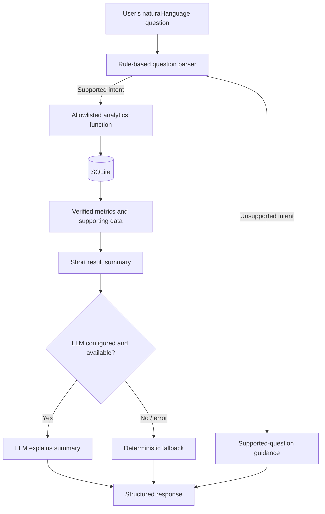

# AI Reflection — Mini AI Business Intelligence Assistant

## 1. Purpose of this reflection

This report records how AI-assisted development was used in building the Mini AI Business Intelligence Assistant, which engineering decisions remained important, what was learned from debugging, and what should improve next. It distinguishes AI assistance during development from the optional LLM feature inside the application.

> **Accuracy note:** The project notes supplied with the source archive state that Kilo Code was used for scaffolding, code generation, and debugging. Before submitting this reflection, edit the wording so it precisely matches the tools, prompts, changes, and tests you personally used. Do not claim a test passed unless you ran it and observed the result.

## 2. Two different uses of AI

| AI usage | Where it happens | Purpose | Is it required at runtime? |
|---|---|---|---|
| AI-assisted software development | During implementation, using Kilo Code according to the existing project notes | Help structure modules, draft code, investigate errors, and create documentation | No |
| Optional LLM explanation | `backend/app/services/llm_service.py` | Turn a verified analytics summary into a concise natural-language explanation | No; default provider is `none` and a deterministic fallback exists |

The distinction matters: the application does not depend on an LLM to calculate revenue. Its numeric results come from the analytics functions and SQLite queries.

## 3. Where AI assistance helped

The existing project notes describe AI assistance in these areas:

| Activity | AI assistance described in the project notes | Engineering responsibility retained by the developer |
|---|---|---|
| Project scaffolding | Suggesting a modular layout for API, data, analytics, and UI responsibilities | Confirming the structure matches the assessment and that imports/run commands work |
| Code drafting | Producing initial code patterns for FastAPI routes, data validation, analytics, and the React UI | Reviewing every file, verifying paths and schemas, and ensuring the implementation matches the actual dataset |
| Debugging | Helping investigate malformed data and behavior around missing price, zero quantity, and returned status | Reproducing the issue, deciding the business rule, running tests, and checking actual output |
| Documentation | Drafting explanations of architecture and AI usage | Correcting overclaims and documenting limitations honestly |
| Test planning | Suggesting endpoint and edge-case coverage | Running the suite and adding tests for behaviors not currently proven |

AI-generated code is a starting point, not evidence that a feature is correct. The strongest workflow is to inspect the code, test assumptions against the supplied data, run targeted tests, and revise based on observed failures.

## 4. Data-quality decisions

The supplied CSV has 51 data rows and these columns:

`Transaction_Id`, `Order_date`, `Product`, `Category`, `Region`, `Sales_channel`, `Quantity`, `Unit_price`, `Discount_amount`, `Status`.

Examples visible in the dataset:

| Transaction | Observation | Chosen behavior in the loader |
|---|---|---|
| `TXN0051` | Missing unit price | Exclude because a valid line revenue cannot be calculated reliably |
| `TXN0034` | Quantity is zero | Exclude because quantity must be positive |
| `TXN0033` | Status is `Returned` | Store if its other fields are valid, but exclude it from completed-revenue calculations |

The revenue rule is:

```text
net_revenue = quantity × unit_price − discount_amount
```

Only transactions whose status is `Completed` contribute to the analytics. The source CSV is read; the loader does not rewrite it or invent a missing unit price. Currency is not specified in the source data, so the application should not label the values as INR or another currency without an authoritative definition.

These rules are business decisions, not just technical cleanup. A different business might represent returns as negative transactions or net them against the original order; that policy would need to be agreed and implemented explicitly.

## 5. How the AI feature is constrained

The optional LLM is not responsible for selecting or executing arbitrary SQL queries. The current request path is:



### Why this boundary is useful

1. **Reproducibility:** Given the same database state, a deterministic analytics function should calculate the same result.
2. **Reduced numeric hallucination risk:** The LLM receives a result summary instead of being asked to calculate the answer from raw data.
3. **Limited execution surface:** The parser chooses among predefined operations rather than running arbitrary SQL generated by a model.
4. **Graceful degradation:** If the model provider is not configured or fails, the assistant can still return a useful deterministic explanation.
5. **Transparency:** Response metadata indicates whether the explanation used the configured provider or the fallback.

This does not guarantee that an LLM's wording will always be perfect. The model could still paraphrase incorrectly. The figures and supporting data should remain the authoritative result, and model output should be evaluated before being trusted in a high-stakes workflow.

## 6. Debugging and lessons learned

The project notes identify missing unit price, zero quantity, and returned status as cases considered during development. The implementation handles them differently because they represent different data semantics.

| Case | Risk if handled carelessly | Current response | Lesson |
|---|---|---|---|
| Missing unit price | Revenue could be fabricated or calculated as zero without justification | Reject and count the row | Do not silently impute financial values |
| Zero quantity | Invalid or meaningless line revenue could enter totals | Reject and count the row | Validate business ranges, not only data types |
| Returned transaction | Revenue could be overstated if returns are counted as completed sales | Keep a valid returned row but filter it out of completed revenue | Status semantics must be applied consistently to every metric |
| Unsupported question | The application could produce an unrelated or invented answer | Return a list of supported question categories | Fail clearly rather than pretending to understand |
| Optional LLM unavailable | The main analytics feature could fail unnecessarily | Use deterministic fallback | Keep core calculations independent from optional services |

The current code also reveals areas that should be improved after review:

- The `/api/data-status` endpoint reports `records_excluded: 0` rather than exposing the last ingestion result.
- `data_cleaner.py` is currently empty; the validation rules live in `data_loader.py`.
- The import clears and commits existing rows before loading the new file, so a mid-import failure is not atomic.
- The test called `test_zero_baseline` currently checks a nonexistent month, not the actual zero-baseline percentage-change branch.
- The parser defaults bare month names to 2026 and recognizes only a limited set of phrasings.

These limitations are valuable review findings. A credible engineering report should disclose them rather than claim that the project is production-ready.

## 7. Testing and verification discipline

The current test file includes tests for:

- health check;
- data status;
- total revenue;
- highest-revenue product;
- monthly revenue trend;
- top region;
- month comparison;
- unsupported question;
- malformed request;
- an unavailable month comparison.

Run the suite from the backend directory:

```bash
source venv/bin/activate
python -m pytest -q
```

Record the actual output before submission. For stronger confidence, add tests for:

1. missing required columns;
2. missing and non-numeric prices;
3. non-positive quantities;
4. invalid dates and statuses;
5. duplicate transaction identifiers;
6. discount greater than gross line amount;
7. repeated data loads;
8. import rollback on failure;
9. empty database behavior;
10. zero baseline for percentage change;
11. LLM disabled, successful, timeout, and error cases;
12. `data-status` reporting the actual last load result.

AI can help generate test ideas, but the test runner—not the AI's statement—determines whether tests pass.

## 8. What I learned

### A. Define business semantics before coding

A metric such as revenue is ambiguous until the team defines discounts, returns, missing values, and currency. Writing down the rule before implementing the query prevents inconsistent calculations.

### B. Keep calculation separate from explanation

The analytics service owns the numerical answer. The optional LLM adds readability. This separation makes the core application usable without a paid API key and easier to test deterministically.

### C. Make assumptions observable

Exclusion counts, reason codes, source paths, and AI-mode metadata help explain how an answer was produced. The current implementation returns ingestion reasons from `/api/load-data`, but it should retain and expose those details from `/api/data-status` too.

### D. Test edge cases, not just happy paths

A successful server startup proves that the application can start; it does not prove that data is correct, month comparison is correct, or error handling works. Each business rule needs a focused test.

### E. Treat AI output as a draft

Generated code, explanations, and documentation need review. It is important to inspect the actual source, run the app, examine API responses, and correct claims that are not supported by the implementation.

## 9. Limitations and next steps

| Priority | Improvement | Why it matters |
|---|---|---|
| P0 | Make CSV import transactional and preserve the previous dataset if loading fails | Prevents partial or empty data after an error |
| P0 | Persist last-load counts and exclusion reasons | Makes data-quality behavior visible to users and evaluators |
| P0 | Add direct tests for zero baseline, empty data, duplicates, and import rollback | Verifies important edge cases |
| P1 | Improve parser coverage and ask for a year when month is ambiguous | Reduces unsupported or misinterpreted questions |
| P1 | Add charts and formatted metric cards | Makes trends easier to understand |
| P1 | Add structured logging and clearer provider error diagnostics | Improves debugging without leaking secrets |
| P2 | Add authentication, request limits, production database, CI/CD, and deployment configuration | Moves the demo toward multi-user production use |
| P2 | Add an evaluation set of natural-language questions with expected operation/results | Measures parser accuracy and guards against regressions |

## 10. Responsible use and confidentiality

The original assessment documents and supplied CSV may be subject to company-specific confidentiality rules. Before making the repository public, verify permission to publish them. Never commit API keys, access tokens, private environment files, or other credentials. If the dataset cannot be published, replace it with synthetic data that preserves the schema and documented edge cases.

## 11. Suggested interview answer

> “I used AI assistance to accelerate scaffolding, code drafting, and debugging, but treated generated output as a proposal that needed review. I designed the application so deterministic analytics functions calculate the actual business metrics from SQLite, while an optional LLM only explains the verified result summary. The main learning was that data-quality and business rules must be explicit: missing prices and zero quantities are excluded, and returned transactions do not contribute to completed revenue. I also identified gaps during review, including non-atomic CSV loading, incomplete data-status reporting, and edge cases that need stronger tests. My next step would be to address those reliability gaps before adding more sophisticated natural-language understanding.”
