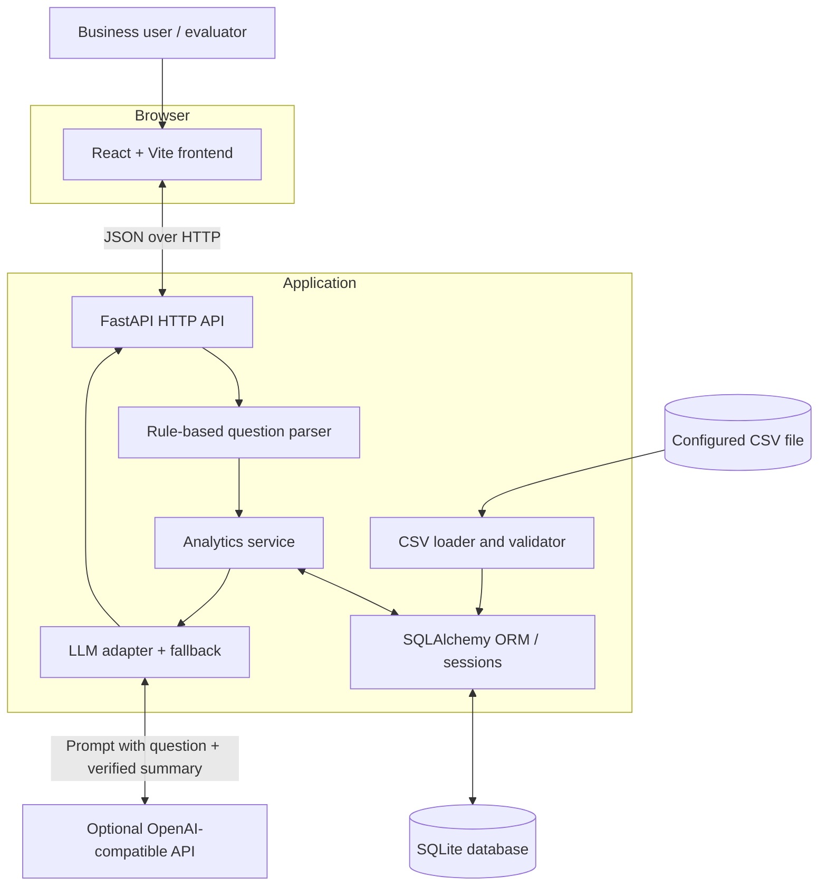
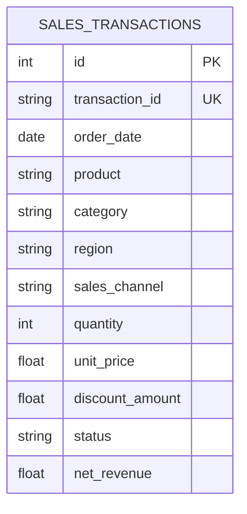
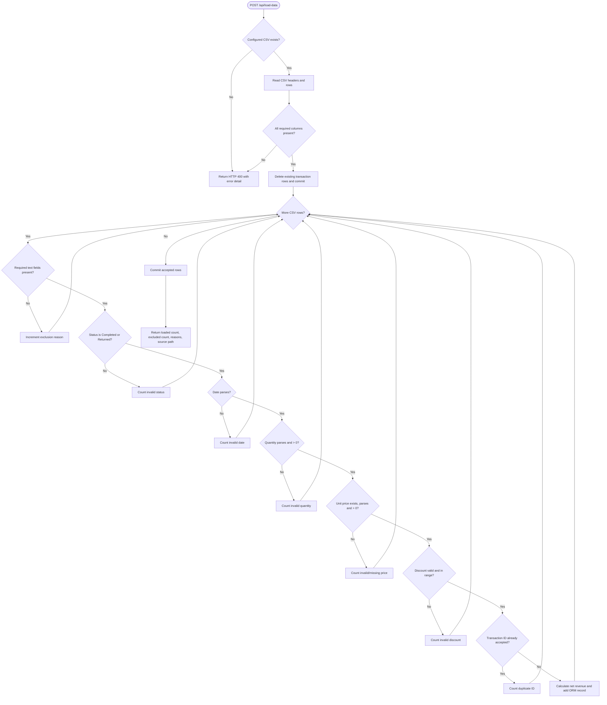
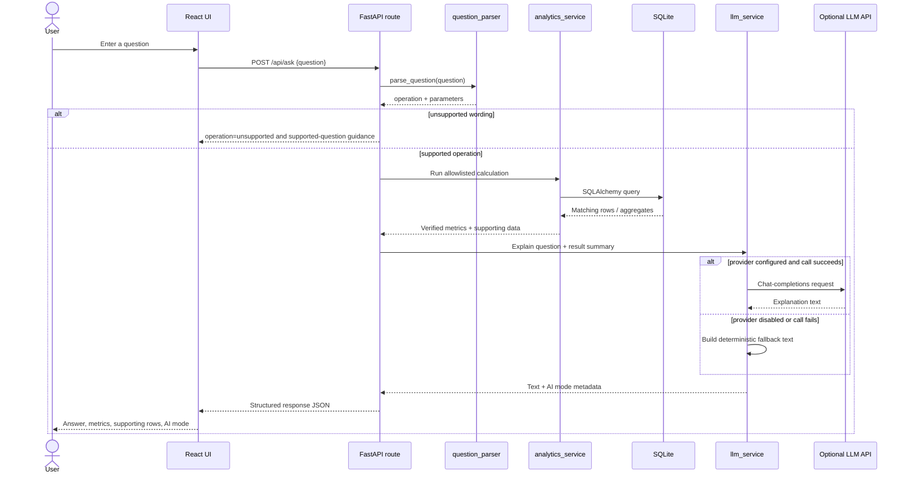

# Architecture — Mini AI Business Intelligence Assistant

## 1. Purpose and scope

This document explains the design of the Mini AI Business Intelligence Assistant from data ingestion through natural-language question answering. The inspected implementation is a **modular monolith**: frontend and backend are separate deployable applications, while the Python backend keeps its API, persistence, parsing, analytics, and explanation code in one application.

The system is a controlled analytics assistant, not an unrestricted agent. It recognizes a small set of supported question patterns and maps them to predefined operations. Business metrics are calculated in Python/SQLAlchemy against SQLite; the optional language model is only asked to explain the verified result summary.

## 2. System context



### Trust boundaries

| Boundary | Data crossing it | Control / consideration |
|---|---|---|
| Browser → FastAPI | Question text and JSON responses | Pydantic request validation; CORS restricts configured browser origins |
| CSV → loader | Untrusted field values | Required-column checks, type parsing, range checks, duplicate-ID tracking |
| Backend → database | Validated transaction fields | SQLAlchemy ORM and typed columns |
| Backend → LLM provider (optional) | User question and concise verified result summary | Provider is opt-in by configuration; do not send confidential data unless permitted |
| Repository → GitHub | Source and documentation | `.gitignore`, secret hygiene, and assessment confidentiality review required |

CORS is a browser policy, not authentication. The application currently has no user login or role-based access control.

## 3. Architectural style and rationale

| Decision | Current choice | Reason | Trade-off |
|---|---|---|---|
| Application organization | Modular monolith | Small project, simple local execution, clear separation by responsibility | Modules share one deployment and runtime |
| API framework | FastAPI | Typed request/response handling and generated OpenAPI docs | Requires disciplined schema and error design |
| Database access | SQLAlchemy ORM | Model-based persistence and session dependency injection | More setup than direct SQL for a tiny dataset |
| Database | SQLite | Zero-service local setup and sufficient for a 51-row demo | Limited concurrency and operational capabilities versus server databases |
| Question parsing | Rules + regular expressions | Predictable, testable, no model needed to select an operation | Paraphrases outside known patterns may not match |
| Numeric calculations | Deterministic analytics functions | Reproducible figures; no LLM arithmetic dependency | New questions require new operations and parser patterns |
| Explanation | Optional LLM adapter plus fallback | Natural-language summary without making the model the source of truth | Model availability, latency, cost, and possible wording errors |
| Frontend | React + Vite | Small interactive UI with quick local development | Current UI is intentionally minimal and uses inline styles |

## 4. Component responsibilities

| Component / file | Responsibility | Input | Output |
|---|---|---|---|
| `backend/app/main.py` | Creates FastAPI app, creates ORM tables, configures CORS, registers routes | Configuration and router | ASGI application |
| `backend/app/config.py` | Loads environment variables and default paths/settings | Environment | Constants for DB, CSV, CORS, and LLM |
| `backend/app/database.py` | Creates SQLAlchemy engine/session factory and `get_db` dependency | `DATABASE_URL` | DB sessions and declarative base |
| `backend/app/models.py` | Defines `SalesTransaction` schema | Validated transaction fields | `sales_transactions` table mapping |
| `backend/app/routes/__init__.py` | Implements HTTP endpoints and coordinates services | HTTP request | JSON response / HTTP errors |
| `backend/app/schemas/__init__.py` | Defines Pydantic request and response types | JSON payloads | Validated request and structured response |
| `backend/app/services/data_loader.py` | Reads CSV, checks columns and rows, calculates `net_revenue`, persists accepted records | CSV path and DB session | Load counts and exclusion reasons |
| `backend/app/services/data_cleaner.py` | Reserved cleaning module | — | Currently empty; validation is implemented in `data_loader.py` |
| `backend/app/services/question_parser.py` | Maps supported wording to operation identifiers and parameters | Question string | Operation and parameter dictionary, or no match |
| `backend/app/services/analytics_service.py` | Computes revenue aggregations using DB queries and Python grouping | DB session and optional month parameters | Numeric metrics and supporting rows |
| `backend/app/services/llm_service.py` | Calls configured compatible chat-completions endpoint; falls back deterministically | Question and verified result summary | Explanation text, provider-used flag, mode |
| `backend/tests/test_api.py` | Exercises routes and basic analytics behavior with a temporary SQLite database | Test requests | Assertions |
| `frontend/src/App.jsx` | Loads data status, submits questions, renders response/errors/supporting data | User input and API JSON | Browser UI |
| `frontend/.env.example` | Documents frontend API base URL | Environment | `VITE_API_URL` |

## 5. Data model

The ORM model is `SalesTransaction`, mapped to `sales_transactions`.

| Field | Database type | Constraints / meaning |
|---|---|---|
| `id` | Integer | Primary key |
| `transaction_id` | String | Unique, indexed, required transaction identifier |
| `order_date` | Date | Required parsed order date |
| `product` | String | Required product |
| `category` | String | Required category |
| `region` | String | Required region |
| `sales_channel` | String | Required channel |
| `quantity` | Integer | Required, positive after validation |
| `unit_price` | Float | Required, positive after validation |
| `discount_amount` | Float | Required, non-negative and no greater than gross line amount |
| `status` | String | `Completed` or `Returned` |
| `net_revenue` | Float | Stored line-level calculation: quantity × unit price − discount |

### Entity relationship

Each row represents one transaction record. There are no separate product, customer, or region tables in the current scope.



## 6. Data ingestion and validation

### Ingestion flow



### Required CSV schema

The loader requires these exact column names:

`Transaction_Id`, `Order_date`, `Product`, `Category`, `Region`, `Sales_channel`, `Quantity`, `Unit_price`, `Discount_amount`, `Status`.

### Validation policy

| Check | Accepted condition | Rejection reason |
|---|---|---|
| Required columns | Every required header is present | Request fails with missing-column message |
| Required text | Transaction ID, product, category, region, channel, and status are non-empty | `missing_required_text` |
| Status | `Completed` or `Returned` | `invalid_status` |
| Date | Parses as `%d-%m-%Y`, `%Y-%m-%d`, or `%m/%d/%Y` | `invalid_date` |
| Quantity | Numeric and integer-convertible, greater than zero | `invalid_quantity` or `non_positive_quantity` |
| Unit price | Present, numeric, greater than zero | `missing_unit_price`, `invalid_unit_price`, or `non_positive_unit_price` |
| Discount | Numeric and non-negative | `invalid_discount` or `negative_discount` |
| Discount ceiling | Discount ≤ quantity × unit price | `excessive_discount` |
| Duplicate ID | ID not already accepted earlier in the same import | `duplicate_transaction_id` |

**Important implementation detail:** `seen_ids` is updated only after a row passes validation. Therefore, a duplicate of a row that was rejected earlier is not treated as a duplicate of an accepted transaction. The loader deletes existing rows and commits before processing the replacement file; this means an import failure mid-way is not currently an all-or-nothing transaction. A production-hardening step would use one transaction and rollback on failure.

### Supplied dataset observations

The inspected CSV contains 51 data rows and 10 columns. Visible quality cases include:

| Row / ID | Issue | Result under current policy |
|---|---|---|
| `TXN0033` | Status `Returned`, otherwise valid fields | Stored if valid, but filtered out of revenue queries |
| `TXN0034` | Quantity `0` | Excluded as non-positive quantity |
| `TXN0051` | Missing `Unit_price` | Excluded as missing unit price |

These are source-derived examples, not a claim that an import/test run was executed while writing this document. The load endpoint returns actual counts when run.

## 7. Analytics semantics

All revenue analytics filter `status == "Completed"`.

| Operation | Calculation | Returned shape (conceptually) |
|---|---|---|
| `total_revenue` | Sum `net_revenue` over completed rows | Total numeric revenue and a currency note |
| `highest_revenue_product` | Group completed rows by product, sum revenue, sort descending | Product and revenue |
| `monthly_revenue` | Group completed rows by year-month of `order_date`, sum revenue | Ordered list of month and revenue |
| `top_region` | Group completed rows by region, sum revenue, sort descending | Region and revenue |
| `compare_months` | `change = month2_revenue - month1_revenue`; percentage = change / month1 revenue × 100 if baseline is non-zero | Both revenues, absolute change, percentage change |

### Business-rule notes

- `net_revenue = quantity × unit_price − discount_amount`.
- Only `Completed` rows contribute to the above revenue operations.
- A `Returned` row can remain in the table for traceability but is not treated as completed revenue.
- Currency is not identified in the CSV; the system must not label the figures with a currency symbol without additional authoritative metadata.
- A zero first-month baseline yields `percentage_change: null`, avoiding division by zero.
- If either month is not present in the monthly aggregation, the route returns HTTP 400.

## 8. Question answering flow



### Supported parser operations

| Operation identifier | Example trigger | Parameters |
|---|---|---|
| `total_revenue` | “What is the total revenue?” | None |
| `highest_revenue_product` | “Which product generated the highest revenue?” | None |
| `monthly_revenue` | “What is the monthly revenue trend?” | None |
| `top_region` | “Which region generated the highest sales?” | None |
| `compare_months` | “How did revenue change between January and February?” | `month1`, `month2` |

The parser is based on lowercased string checks and regular expressions. It is not a general semantic parser, RAG system, vector search system, or autonomous agent. A question may be meaningful to a person but still be unsupported if it does not match the current patterns.

## 9. API contracts

| Method and path | Request | Success behavior | Error / caveat |
|---|---|---|---|
| `GET /health` | None | `status: ok` and application name | Does not verify database connectivity |
| `GET /api/data-status` | None | Transaction row count and source path | `records_excluded` is currently hardcoded to `0` |
| `POST /api/load-data` | No body; uses configured CSV path | Loaded/excluded counts and reason breakdown | Loader errors are returned as HTTP 400 |
| `POST /api/ask` | `{"question": "..."}` | Operation, answer, metrics, supporting data, data-quality metadata, AI metadata | Invalid request body is rejected by Pydantic; absent month data returns HTTP 400 |

The exact request and response schema is defined in `backend/app/schemas/__init__.py`. Run the backend and open `/docs` to inspect the generated OpenAPI contract.

## 10. LLM boundary and fallback

The explanation adapter in `llm_service.py` is deliberately downstream of deterministic analytics.

1. The analytics layer computes a result.
2. The route converts the result to a concise summary.
3. If `LLM_PROVIDER` is `openai` or `openai-compatible` and `LLM_API_KEY` is set, the adapter sends the question and verified summary to `{LLM_BASE_URL}/chat/completions`.
4. The system prompt tells the model to explain the provided result in one or two sentences and not change numbers.
5. If no provider is configured or an exception occurs, a deterministic sentence is returned.

This arrangement reduces the risk of fabricated numeric answers, but does not eliminate the possibility that a model paraphrases a result inaccurately. The API includes `ai.used` and `ai.mode` metadata so a caller can distinguish provider-backed explanation from fallback. In the current default configuration, `LLM_PROVIDER=none`, so no external LLM call occurs.

## 11. Configuration and runtime

| Setting | Purpose |
|---|---|
| `DATABASE_URL` | SQLAlchemy database URL; defaults to SQLite |
| `CSV_PATH` | Location of input CSV |
| `CORS_ORIGINS` | Allowed browser origins |
| `LLM_PROVIDER` | `none`, `openai`, or `openai-compatible` |
| `LLM_API_KEY` | Secret for optional provider |
| `LLM_MODEL` | Model identifier |
| `LLM_BASE_URL` | Provider-compatible API base URL |
| `VITE_API_URL` | Frontend API base URL |

The database engine is initialized at import time and `Base.metadata.create_all()` runs when the FastAPI app is imported. This is convenient for a small local assessment, but a larger service should use explicit startup management and database migrations.

## 12. Tests and verification

The current `backend/tests/test_api.py` uses a temporary SQLite database and overrides the application's database dependency. The test cases cover:

- health endpoint;
- data-status endpoint;
- total revenue;
- highest-revenue product;
- monthly trend;
- top region;
- month comparison;
- unsupported question;
- malformed request;
- a month-comparison edge case with a nonexistent month.

Run:

```bash
cd backend
source venv/bin/activate
python -m pytest -q
```

The last test named `test_zero_baseline` currently checks a nonexistent month returns `None`; it does **not** prove the `r1 == 0` percentage-change branch. Add a dedicated fixture containing a month with zero completed revenue if that behavior needs direct coverage. Do not report tests as passing until the command has actually completed successfully.

## 13. Known limitations and production hardening

| Area | Current limitation | Suggested improvement |
|---|---|---|
| Data-status accuracy | Exclusion count is hardcoded to zero | Persist last-load metadata and expose actual reasons/counts |
| Import atomicity | Existing table is cleared and committed before new rows are processed | Use a transaction with rollback, stage then swap |
| Data cleaning module | `data_cleaner.py` is empty | Move reusable validation and normalization into it or remove it |
| Duplicate policy | Duplicate IDs are tracked only after accepted rows | Define whether every seen identifier should block later copies |
| Month parser | Bare month names default to 2026 | Ask for year or infer only when unambiguous from data |
| Natural language | Regex/string matching only | Add richer intent parsing while retaining operation allowlist |
| LLM reliability | Exceptions silently trigger fallback | Add structured logs, provider timeout/error metrics, and safe diagnostics |
| UI | Minimal inline-styled interface; metrics JSON displayed directly | Add accessible form behavior, formatting, charts, and table labels |
| Security | No authentication or rate limiting | Add auth, quotas, request-size limits, and deployment security controls |
| Observability | Minimal logs | Add structured logs, request IDs, and health checks that verify dependencies |
| Database | SQLite file | Use managed PostgreSQL for concurrent multi-user deployment |
| Test coverage | Basic route coverage and limited edge cases | Test import rollback, duplicate cases, all validation branches, LLM failure, empty DB, zero baseline |
| Deployment | Local development configuration | Add containerization, CI pipeline, production server config, and secret management |

## 14. Interview explanation (60–90 seconds)

> “I built a modular-monolith business intelligence assistant with a React/Vite frontend and a FastAPI backend. The ingestion endpoint reads the supplied CSV, validates required fields and numeric/date constraints, computes net revenue, and stores accepted transactions in SQLite through SQLAlchemy. When a user asks a question, a rule-based parser maps it to one of five allowlisted analytics operations. The analytics service calculates the actual figures from the database and returns metrics plus supporting data. An optional LLM adapter explains the verified summary; if the provider is disabled or fails, the service returns a deterministic fallback. This keeps the model out of the numeric calculation path and avoids executing arbitrary model-generated SQL. The main trade-offs are the limited parser coverage, local SQLite storage, and the need for stronger ingestion atomicity, data-status reporting, and edge-case tests before production use.”
