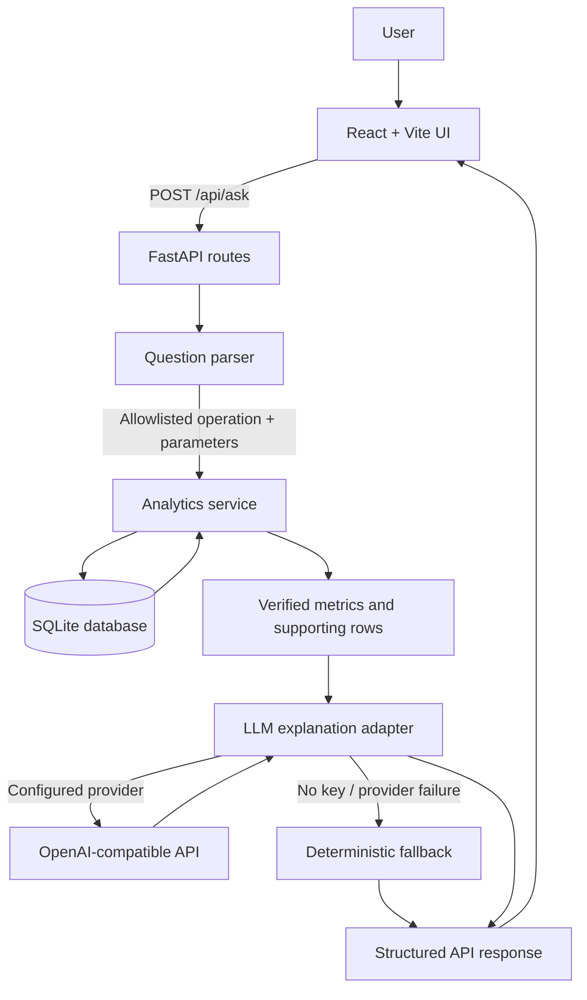
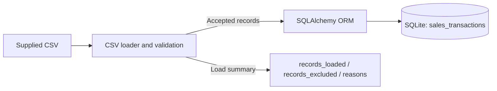

# Mini AI Business Intelligence Assistant

> A full-stack sales analytics application that lets users ask supported business questions in natural language and receive database-backed metrics with a readable explanation.

## At a glance

| Item | Implementation |
|---|---|
| Application style | Modular monolith |
| Frontend | React 19, Vite |
| Backend API | Python, FastAPI, Pydantic |
| Data processing | Python CSV reader and validation logic; Pandas is available in dependencies |
| Persistence | SQLite through SQLAlchemy ORM |
| Question understanding | Rule-based, allowlisted question parser |
| Optional AI explanation | OpenAI-compatible Chat Completions API, when configured |
| Fallback | Deterministic explanation based on computed results |
| Automated tests | Pytest and FastAPI TestClient / HTTPX |
| Dataset | Supplied sales CSV, 51 data rows |

## Why this project exists

Business users often know the question they want answered—such as “Which product generated the highest revenue?”—but may not know SQL or how to build a report. This application provides a small, controlled interface between natural-language questions and predefined analytics operations.

The system does **not** ask an LLM to invent business figures. The backend calculates figures from the database first. If an LLM is configured, it receives the verified result summary and is asked to explain it without changing the numbers. If no provider is configured or the call fails, the application returns a deterministic fallback explanation.

## Core capabilities

| Capability | How it works | Current implementation notes |
|---|---|---|
| Load CSV data | `POST /api/load-data` reads the configured CSV, validates fields, and stores accepted records in SQLite | Uses a configured file path; it is not a browser file-upload endpoint |
| Inspect data status | `GET /api/data-status` returns the current transaction count and source path | The current response reports `records_excluded: 0`; it does not persist the last load's exclusion report |
| Total revenue | Sums net revenue for `Completed` records | Net revenue = quantity × unit price − discount |
| Highest-revenue product | Groups completed revenue by product and ranks descending | Returns the leading product and its revenue |
| Monthly revenue trend | Aggregates completed revenue by `YYYY-MM` | Months are returned in chronological order |
| Highest-revenue region | Groups completed revenue by region and ranks descending | Based on revenue, not transaction count |
| Compare two months | Compares revenue for two months and calculates absolute and percentage change | Month parsing supports month names (default year 2026), `YYYY-MM`, and `M/YYYY` forms |
| Explain results | Optional LLM explanation or deterministic fallback | LLM is optional; default provider is `none` |
| Interactive UI | React interface with example questions, loading/error states, metrics and supporting data | API URL can be configured with `VITE_API_URL` |

## Architecture overview



The data-ingestion path is separate from question answering:



See [ARCHITECTURE.md](ARCHITECTURE.md) for component responsibilities, data policies, API contracts, and design trade-offs. See [AI_REFLECTION.md](AI_REFLECTION.md) for AI usage, limitations, debugging notes, and future improvements.

## Repository layout

```text
mini-bi-assistant/
├── backend/
│   ├── app/
│   │   ├── main.py                 # FastAPI app, CORS, table initialization
│   │   ├── config.py               # Environment-based configuration
│   │   ├── database.py             # SQLAlchemy engine, sessions, Base
│   │   ├── models.py               # SalesTransaction ORM model
│   │   ├── routes/
│   │   │   └── __init__.py         # Health, data, and question endpoints
│   │   ├── schemas/
│   │   │   └── __init__.py         # Request/response validation schemas
│   │   └── services/
│   │       ├── data_loader.py      # CSV parsing, validation, DB loading
│   │       ├── data_cleaner.py     # Reserved module; currently empty
│   │       ├── analytics_service.py
│   │       ├── question_parser.py
│   │       └── llm_service.py
│   ├── data/
│   │   └── ai_bi_assistant_sales_data - GET.csv
│   ├── tests/
│   │   └── test_api.py
│   ├── requirements.txt
│   └── .env.example
├── frontend/
│   ├── src/
│   │   ├── App.jsx
│   │   ├── App.css
│   │   └── main.jsx
│   ├── package.json
│   └── .env.example
├── docs/
│   ├── architecture.md             # Existing brief architecture note
│   └── ai-development-report.md    # Existing brief AI development note
├── README.md
├── ARCHITECTURE.md                 # Expanded architecture documentation
└── AI_REFLECTION.md                # Expanded AI development reflection
```

The tree is a guide to the source archive inspected for this documentation. Exclude local `.git/`, `venv/`, `node_modules/`, and generated `dist/` files from source control.

## Dataset and data-quality policy

The supplied CSV contains **51 transaction rows** with these columns:

| Column | Meaning | Validation / use |
|---|---|---|
| `Transaction_Id` | Transaction identifier | Required, unique in accepted rows |
| `Order_date` | Order date | Parsed from supported date formats |
| `Product` | Product name | Required text |
| `Category` | Product category | Required text |
| `Region` | Sales region | Required text |
| `Sales_channel` | Sales channel | Required text |
| `Quantity` | Units sold | Must parse as an integer and be greater than zero |
| `Unit_price` | Price per unit | Required numeric value greater than zero |
| `Discount_amount` | Discount applied | Numeric, non-negative, and no greater than quantity × unit price |
| `Status` | Transaction state | Must be `Completed` or `Returned` |

### Revenue definition

```text
net_revenue = quantity × unit_price − discount_amount
```

Only rows whose status is `Completed` contribute to the analytics. A valid `Returned` row can be stored, but is excluded from revenue calculations. Invalid rows are excluded during ingestion and counted by reason in the load response.

### Known examples in the supplied data

| Data issue | Observed example | Current handling |
|---|---|---|
| Missing unit price | Transaction `TXN0051` has an empty `Unit_price` | Excluded during loading |
| Non-positive quantity | Transaction `TXN0034` has quantity `0` | Excluded during loading |
| Returned transaction | Transaction `TXN0033` has status `Returned` | May be stored if otherwise valid; not included in completed revenue |
| Duplicate identifier | No duplicate is apparent in the supplied 51-row CSV | Loader tracks IDs and excludes repeated IDs encountered after an accepted row |

The source file is not rewritten. Cleaning decisions happen while loading data. The API does not infer missing prices or silently replace invalid values.

> **Interpretation note:** The currency is not specified by the dataset. The application therefore returns numeric revenue and labels the currency as “not specified”; do not assume INR or another currency without an authoritative data definition.

## Supported questions

Use questions close to these examples:

1. **Total revenue:** “What is the total revenue?”
2. **Highest-revenue product:** “Which product generated the highest revenue?”
3. **Monthly trend:** “What is the monthly revenue trend?”
4. **Top region:** “Which region generated the highest sales?”
5. **Month comparison:** “How did revenue change between January and February?”

Question handling is intentionally limited to predefined operations. Unsupported questions receive an explanatory response rather than arbitrary database execution.

## API reference

| Method | Endpoint | Purpose |
|---|---|---|
| `GET` | `/health` | Basic health response |
| `GET` | `/api/data-status` | Number of transactions currently in the database and source path |
| `POST` | `/api/load-data` | Load and validate the configured CSV into SQLite |
| `POST` | `/api/ask` | Parse a supported question and return metrics plus explanation |

### Example: load the dataset

```bash
curl -X POST http://127.0.0.1:8000/api/load-data
```

### Example: ask a question

```bash
curl -X POST http://127.0.0.1:8000/api/ask \
  -H "Content-Type: application/json" \
  -d '{"question":"What is the total revenue?"}'
```

A successful answer contains fields such as `question`, `operation`, `answer`, `metrics`, `supporting_data`, `data_quality`, and `ai`. Consult the interactive API docs for the exact schema.

## Local setup

### Prerequisites

- Python 3.12 recommended for the current environment
- Node.js and npm (for the frontend)
- Git

### 1. Backend

From the repository root:

```bash
cd backend
python3 -m venv venv
source venv/bin/activate
python -m pip install -r requirements.txt
cp .env.example .env
```

Review `backend/.env` and make sure `CSV_PATH` points to the supplied CSV. The default relative path is intended to be used with the backend directory as the working directory.

Start the API:

```bash
python -m uvicorn app.main:app --reload --port 8000
```

Load the data in a second terminal:

```bash
curl -X POST http://127.0.0.1:8000/api/load-data
```

Open the API explorer at [http://127.0.0.1:8000/docs](http://127.0.0.1:8000/docs).

### 2. Frontend

In a separate terminal:

```bash
cd frontend
npm install
cp .env.example .env
npm run dev
```

Open [http://localhost:5173](http://localhost:5173). Ensure the backend is running and `VITE_API_URL` points to it.

### 3. Tests

```bash
cd backend
source venv/bin/activate
python -m pytest -q
```

The test suite includes health, data status, the five supported analytics operations, unsupported questions, and malformed requests. **Run the tests in your environment and report the actual result; this documentation does not claim that tests have been executed during its preparation.**

## Configuration

| Variable | Default | Purpose |
|---|---|---|
| `DATABASE_URL` | `sqlite:///./sales.db` | SQLAlchemy database URL |
| `CSV_PATH` | `./data/ai_bi_assistant_sales_data - GET.csv` | CSV path, relative to backend working directory by default |
| `CORS_ORIGINS` | Local Vite origins | Comma-separated frontend origins |
| `LLM_PROVIDER` | `none` | `none`, `openai`, or `openai-compatible` |
| `LLM_API_KEY` | Empty | Provider API key; keep secret |
| `LLM_MODEL` | `gpt-4o-mini` | Model name for compatible chat completions |
| `LLM_BASE_URL` | `https://api.openai.com/v1` | Compatible API base URL |
| `VITE_API_URL` | `http://localhost:8000` | Frontend API base URL |

Never commit `.env` files, tokens, or credentials. The `.env.example` files should contain placeholders only.

## Limitations and next steps

- Question understanding is rule-based and only covers five analytics operations; it is not a general-purpose conversational agent.
- Optional LLM use is for explanation, not for calculation or database query generation.
- The data-status endpoint currently reports `records_excluded: 0` rather than returning the previous ingestion summary; the load endpoint itself returns exclusion counts and reasons.
- `data_cleaner.py` is currently empty; validation logic lives in `data_loader.py`.
- Month-name parsing defaults to 2026, matching the supplied dataset; multi-year datasets need clearer year extraction.
- No authentication or authorization is implemented; this is a local assessment prototype.
- SQLite is appropriate for a small demo, not a high-concurrency production deployment.
- Add stronger tests for repeated ingestion, rollback behavior, zero-baseline percentage changes, and LLM failure paths.
- Add charts, richer filters, pagination, structured logging, CI, and deployment configuration if the project scope expands.

## Responsible use

Use only data you are permitted to share. Before publishing the repository, verify that the assessment terms permit publication of the source CSV and do not upload confidential assessment documents or credentials. For a public portfolio, consider replacing proprietary sample data with a synthetic dataset while retaining the schema and documented behavior.
